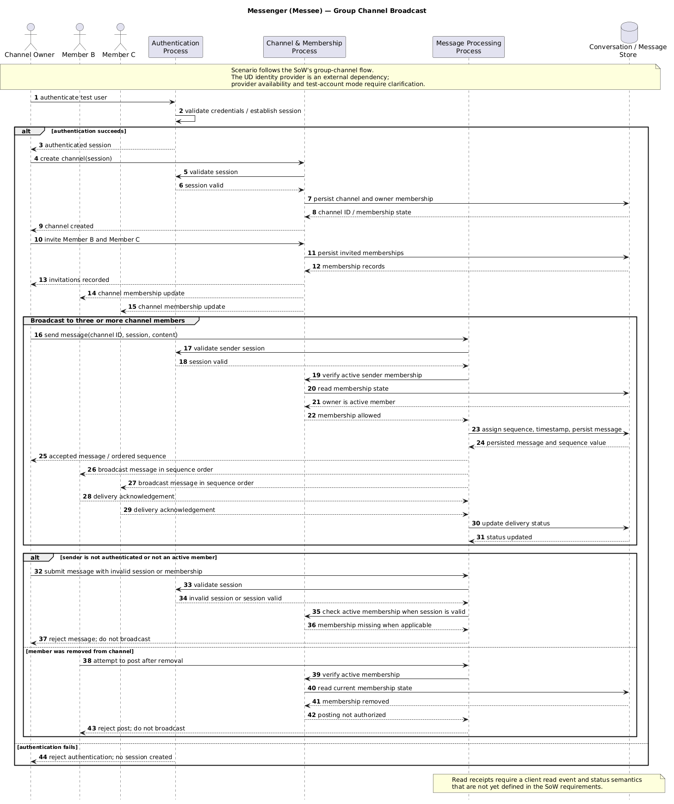

---

# Executive Summary & Engineering Purpose

This reflection evaluates the potential positive and negative impacts of **Messenger**—a real-time messaging application designed for the University of Dayton community—across eight core dimensions of design impact. It connects identified risks directly to concrete engineering requirements (`FR-12`, `FR-13`, `FR-14`, `NFR-05`, `NFR-06`), demonstrates how ethical analysis shapes software architecture, and documents human-in-the-loop oversight in accordance with course standards.

---

# Design Impact Analysis

### Cultural Impact
* **Positive Impact:** Messenger fosters inclusive collaboration among diverse student organizations, academic project teams, and campus interest groups by providing a shared, university-verified platform that eliminates fragmented third-party channels, such as Slack, GroupMe, and Discord.
* **Negative Impact:** Default language settings or poorly contrasted UI elements could inadvertently exclude non-native English speakers or visually impaired campus community members.
* **Mitigation:** Enforce high-contrast UI design standards, support UTF-8 character encoding across all message payloads (`FR-05`, `FR-08`), and structure client interfaces to support future localization and screen-reader accessibility tools.

### Economic Impact
* **Positive Impact:** By enforcing a zero-cost local execution and open-source deployment constraint (`NFR-07`), Messenger guarantees equal access to communication tools for all students regardless of financial status, avoiding paid subscription paywalls or enterprise software fees.
* **Negative Impact:** Excessive network bandwidth consumption or unoptimized polling mechanisms could impose data costs on students utilizing limited mobile data plans or low-bandwidth connections.
* **Mitigation:** Implement lightweight WebSocket event framing and payload optimization (< 2 KB per text message), ensuring low resource consumption and efficient network utilization (`NFR-01`).

### Environmental Impact
* **Positive Impact:** As a lightweight, text-focused application that explicitly excludes high-bandwidth media streaming, voice, and video channels from its scope boundary, Messenger consumes minimal compute energy compared to resource-intensive commercial alternatives.
* **Negative Impact:** Unindexed database queries, continuous spin-wait loops, or redundant client-server polling could cause unnecessary CPU utilization and power consumption on host server infrastructure.
* **Mitigation:** Utilize indexed database lookup schemas (`D1 User Store`, `D3 Message Store`) and asynchronous event-driven I/O patterns to maintain low compute overhead and idle-state power efficiency.

### Global Impact
* **Positive Impact:** Messenger enables international students to maintain instant, zero-cost communication with campus academic groups and peers across global time zones without incurring international SMS fees.
* **Negative Impact:** Displaying local client timestamps without standardized time-zone handling could lead to misaligned message ordering, missed academic deadlines, or confusion across international boundaries.
* **Mitigation:** Enforce ISO-8601 UTC server timestamps for all message metadata (`FR-17`), delegating local time formatting strictly to the client UI layer to guarantee chronological state consistency (`FR-16`).

### Public Health Impact
* **Positive Impact:** Provides a structured, peer-supported digital environment that reduces academic isolation and facilitates collaborative problem-solving among university students.
* **Negative Impact:** Uncontrolled late-night messaging notifications or persistent, unwanted communications can contribute to sleep disruption.
* **Mitigation:** Provide user-controlled contact blocking (`FR-12`) and channel notification toggles, enabling students to establish personal digital boundaries and restrict unwanted interactions.

### Public Safety Impact
* **Positive Impact:** Enables rapid dissemination of group announcements, study group coordination, and campus safety information across verified student channels.
* **Negative Impact:** Bad actors could attempt to leverage instant messaging for malicious coordination, stalking, academic dishonesty, or sending anonymous threats to campus community members.
* **Mitigation:** Authenticate all user accounts through university-verified credentials (`FR-01`), maintain immutable, gapless sequence numbers (`FR-16`) and UTC timestamps (`FR-17`), and strictly reject unauthenticated or spoofed messaging calls (`FR-04`).

### Public Welfare Impact
* **Positive Impact:** Democratizes communication access across student organizations while protecting user privacy through on-premise, zero-cost hosting that prevents third-party commercial data monetization.
* **Negative Impact:** Credential theft or session hijacking could expose private student communications, compromising personal privacy and eroding institutional trust in campus software infrastructure.
* **Mitigation:** Mandate salted cryptographic password hashing (`NFR-05`), generate 256-bit cryptographically random session tokens (`NFR-06`), and enforce strict session invalidation upon logout (`FR-03`).

### Social Impact
* **Positive Impact:** Strengthens campus social cohesion, facilitates student organization governance, and provides reliable 1-on-1 and group communication channels.
* **Negative Impact:** Group channels and private DMs can become vectors for targeted cyberbullying, personal harassment, unauthorized exclusion, or toxic group dynamics.
* **Mitigation:** Implement strict server-side contact blocking (`FR-12`), silent block enforcement (`FR-13`), and administrative member removal/moderation controls (`FR-14`) to give users and group leaders effective tools against harassment.

---

# Connecting Ethics to Engineering

### Impact 1: Targeted Cyberbullying and Unwanted Contact (Social & Public Health)
1. **Affected Stakeholders:** Individual student users subjected to persistent harassment, unwanted direct messaging, or online stalking by malicious handles.
2. **Potential Harm:** Severe emotional distress, academic disruption, compromised personal safety, and psychological fatigue caused by an inability to prevent unwanted messages.
3. **Proposed Mitigation:** Construct a server-side contact blocking subsystem (`3.0 Check Block List`) that intercepts direct messaging requests before transmission. If the recipient has blocked the sender, the server rejects message persistence and delivery. Furthermore, the rejection is handled silently/generically without alerting the blocked sender, preventing retaliation or escalation.
4. **Engineering Influence:** Enforces a mandatory blocklist validation interceptor in the messaging pipeline before any payload is written to `D3 Message Store` or pushed via WebSocket handlers.
5. **Requirement Traceability:**
   * **`FR-12` (User Contact Blocking):** "The system shall allow an authenticated user to add another user handle to a persistent block list."
   * **`FR-13` (Silent Server-side Rejection):** "The system shall silently reject direct messaging attempts from blocked users without transmitting the payload or notifying the sender."
   * **`AC-04` (Blocking Acceptance Criterion):** Verified via scenario test where blocked direct messages fail delivery while the recipient's inbox remains untouched.

### Impact 2: Credential Compromise and Session Hijacking (Public Welfare & Public Safety)
1. **Affected Stakeholders:** All registered student users whose personal chat histories, identity handles, or authentication credentials could be intercepted or exposed.
2. **Potential Harm:** Identity impersonation, unauthorized access to private student conversations, exposure of sensitive personal information, and loss of institutional trust.
3. **Proposed Mitigation:** Eliminate plain-text credential storage by enforcing salted cryptographic hashing algorithms prior to persistence in `D1 User Store`. Require cryptographically secure 256-bit random session tokens for all active API/WebSocket connections, automatically rejecting unauthorized calls with HTTP 401/403 status codes.
4. **Engineering Influence:** Dictates user database table schema constraints, password ingestion logic, and session validation middleware across all API routes.
5. **Requirement Traceability:**
   * **`NFR-05` (Salted Password Hashing):** "User credentials shall be stored using salted cryptographic password hashing algorithms."
   * **`NFR-06` (Session Token Security):** "Active session identifiers shall be cryptographically random 256-bit tokens."
   * **`FR-03` (Session Token Issuance):** "Upon successful authentication, the system shall issue a secure session token."
   * **`FR-04` (Unauthenticated Request Rejection):** Rejects unauthenticated calls across all message endpoints.
   * **`AC-01` (Auth Acceptance Criterion):** Verified via automated test checking registration, session generation, and HTTP 401 rejection on unauthenticated calls.

---

## AI-Assisted Work

+ **Data Flow & Sequence Diagram Creation:** I used ChatGPT to build an outline for my mermaid diagrams, as it is not a tool I have much experience with. This gave me the outline code I needed to begin editing based on my specifications for Messenger.
+ The original sequence diagram shown below generated three users on the left side of the sequence to symbolize the applications functionality with group channel broadcasting. However, I made a suggestion in the next prompt to align with one-on-one communication as intuition follows that recipient does not necessarily have to mean only one individual user, but can reflect a single node in the diagram. This gave a cleaner, more readable diagram that has the sender listed on the left side, and the recipient on the right side. Now, group channel broadcasting can be adapted from one-on-one messaging by using the sender/reciever relationship. The other benefit of this change was that it does not restrict all uses of the app to exactly 3 person communications.
+ I verified these diagrams were both correct by manually comparing all functional and non-functional requirements listed in my documentation to the nodes listed in the data flow diagram. I traced the logic of the sequence diagram from login authentication to message receival, including all potential errors that could occur.

