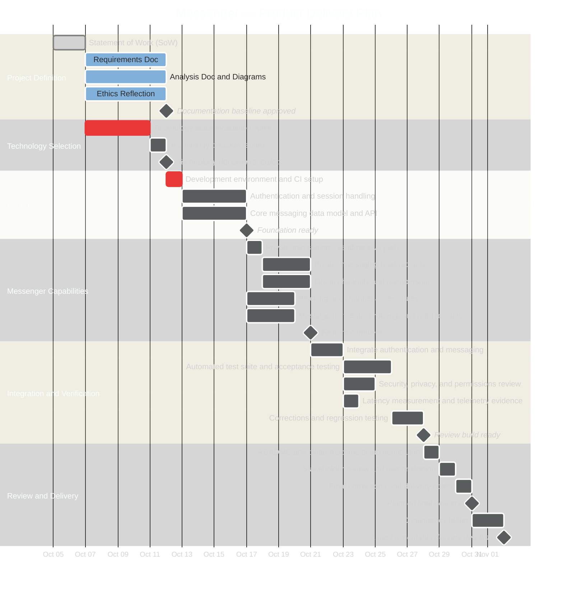

# Statement of Work

> **Document status:** Draft
> **Student:** Andrew Golias
> **Faculty mentor:** Nick Stiffler
> **Project period:** 9/30 - 11/2
> **Version:** 1.0
> **Last Updated:** 10/11/2026

---

## 1. Project Purpose & Objectives

This Statement of Work (SoW) defines the engineering objectives, technical scope, architectural constraints, deliverables, and acceptance criteria outline of the messenger application - **Messenger**.

Study groups, college friends, and student organizations currently coordinate across fragmented channels, such as email, text, Slack, GroupMe, and more. This requires transferring an unknown ID, creating barriers when connecting with others. Messenger addresses this by authenticating through the University of Dayton's login page, enforcing strict two-factor authentication, and easy access to searching for verified user in the UD community.

The project will allow for private messaging and group communications, as well as allow users to create a profile with a unique identifier for adding friends. The technology stack is deliberately unselected at the moment, as it will be provided by the Faculty Mentor upon completion of initial documentation. The goal of this project is to apply software engineering principles, such as architectural  evaluation, documentation workflows, and automated verification.

**Primary Product Objective:**

+ Enable authenticated users to hold real-time one-to-one and multi-user conversations with reliable ordering and persistent history.

**Secondary System Objectives:**

+ Establish robust user access control and group administration, including channel creation, member invitation, user removal/blocking
+ Ensure real-time message ordering and state consistency across concurrent client sessions
+ Capture message telemetry: message timestamps, delivery status, and read receipts
+ Produce a reproducible software package featuring automated test pipelines, clean deployment, and architectural documentation

## 2. Stakeholders

*Stakeholders include those who are involved in the creation, distribution, or handling of the product:*

+ **Faculty Mentor (Nick Stiffler) -** acting client; supplies requirements and tech stack, approves and oversees scope changes, performs final acceptance
+ **Developer (Andrew Golias) -** software engineer; owns design, implementation, verification, and documentation
+ **End Users -** send/receive private messages, join channels, control who may contact them; create channels, invite/remove members, moderate content
+ **Evaluators/testers -** run the build from a clean machine following the README

## 3. Scope

**3.1 In Scope:**

1. User Authentication & Identity Management: user registration, login authentication, and active session handling
2. Private Direct Messaging: direct text-based conversations between two authenticated users with real-time message delivery and message history retrieval
3. Group-Based Channel Messaging: creation of multi-user groups/servers and message broadcasting to all active channel members.
4. User Isolation: user contact blocking (preventing blocked users from sending direct messages) and group member invitations
5. Message Metadata & State Tracking: message sequence numbering, timestamps, delivery indicators (sent, delivered, read), and persistence
6. Technology Stack Evaluation: formal comparison and selection spike among candidate runtime environments, database engines, and networking protocols
7. Automated Verification & Telemetry: test scripts validating functional specs, message schemas, latency metrics, and clean-machine setup

**3.2 Out of Scope Unless Added Through Change Control:**

1. File/Image attachments: large file attachments sent through either channel form
2. Message editing: sent messages can be edited using an editor to resend the message at its original timestamp with a new value
3. Voice and Video Calling: real-time audio or video streaming channels
4. Screen Sharing & Media Streaming: live video broadcasting or desktop screen sharing capabilities
5. End-to-End Encryption Key Infrastructure: client-side key exchange (standard transport-layer security and hashing are in scope)
6. Third-Party Bot/Plugin Ecosystem: extensible API hooks for automated external bots or custom integrations
7. Paid Commercial Cloud Infrastructure: deployment to paid cloud infrastructure; deployment is limited to local or free-tier hosting
8. Native Mobile Apps: dedicated iOS or Android apps

## 4. Deliverables

| ID | Deliverable | Location | Acceptance Evidence |
| :--- | :--- | :--- | :--- |
| D1 | **Documentation** | `docs/` | SoW, requirements, analysis, and ethics reflection artifacts presented at repository location and describe the system |
| D2 | **Diagrams** | `docs/diagrams/` | Data Flow and Sequence Diagrams rendered output that reflect the scope mentioned above in (3) |
| D3 | **Reviewable Messenger Application** | `README.md` | A runnable build containing earlier specified capabilities, further instructions on building the app will be documented in the root repository README |
| D4 | **Automated test suite** | `tests/` | Suite executes with a 100% pass rate and contains at least one test per acceptance criterion |
| D5 | **Verification Evidence** | `docs/verification/` | All acceptance criteria measured and verified in screenshots or through physical testing |
| D6 | **Reviewable Application Build** | `README.md` | Runs from clean Debian machine using README instructions |

#### Acceptance Criteria

+ **Authentication and identity** - A new account can be registered and authenticated; an authenticated session is established and expires or is invalidated on logout; unauthenticated requests to messaging endpoints are rejected
+ **Private direct messaging** - Two authenticated clients exchange messages in real time; message history is retrievable after client restart; delivery and read status are displayed
+ **Group channel creation and membership** - A user creates a channel, invites a second user, and both observe the resulting membership state
+ **Group channel broadcasting** - A message sent to a channel with three or more members is received by all connected members in the same order, with delivery status displayed
+ **Message ordering and metadata** - Messages in all conversations display timestamps and a consistent order. Any delivery/read status included in the build behaves as defined in the requirements.
+ **Blocking and moderation** - A blocked user's direct messages are rejected; a channel creator removes a member and that member can no longer post
+ **Message ordering and state consistency** - With at least two concurrent clients, message sequence numbers are strictly increasing per conversation and all clients converge on identical ordering

## 5. Assumptions, Constraints, & Dependencies

#### Assumptions

1. **Environment Availability:** the product customer and tester will evaluate the project on a Debian Linux operating system with command-line terminal access
2. **Review Access:** the customer will be available for milestone reviews, scope change requests, and final project sign-off
3. **Transport Standard:** networking protocols can operate reliably over standard local ports without firewall restrictions
4. **Expected Concurrent-Session Load:** maximum of 5 simultaneous clients to ensure state consistency
5. **Test Only:** users must pass initial UD login, but no user login will store real information; test accounts are fake simulation data if stored

#### Project Constraints

1. **Deadline:** initial SoW and documentation will be submitted on **October 12, 2026**. The rest of the project, including all deliverables and documentation, will be completed and submitted by **November 2, 2026**
2. **Technology Neutrality Policy:** the project must not rely on paid cloud infrastructure; deployment must run locally or on open-source/free-tier hosting
3. **Single-Developer Effort:** work is budgeted around course expectation for a single student developer across semester window
4. **Bounded product scope:** the project delivers the capabilities defined in this SoW, not a full replacement for a commerical messaging platform

#### Dependencies

1. **SoW Scope Approval:** formal sign-off on this document by Faculty Mentor prior to beginning messaging app development
2. **Tech Evaluation Gate:** successful execution of the technology spike before locking down the database schema and transport architecture
3. **University authentication access:** production UD login and 2FA integration require approval, interace details, and access from the relevant UDIT service owner

## 6. Milestones & Schedule

> See `docs/diagrams/schedule.mmd` to view light theme for accessibility issues

### Legend

| Symbol | Meaning |
|---|---|
| **Critical task** (red) | A task on the critical path; delays may move the final delivery date. |
| **Completed task** (light grey) | Work that has been finished. |
| **Active task** (blue) | Work currently in progress. |
| **Future task** (dark grey) | Future work planned. |
| **Milestone** (diamonds) | A zero-duration approval, decision, or delivery checkpoint. |

## 7. Acceptance

Final acceptance of the Messenger application requires fulfilling the following:

1. **Automated Verification:** the automated test suite must execute with a 100% pass rate, validating direct messaging, group broadcasts, and blocking behaviors
2. **Clean-machine verification:** a reviewer provisions the application from a clean Debian environment following the README only
3. **Live Demonstration:** the developer will demonstrate real-time one-on-one direct messaging, group channel creation, and user blocking in an environment with multiple active client sessions
4. **Sign Off:** Faculty Mentor records acceptance for deliverables; those that are not accepted are returned for review after correction
